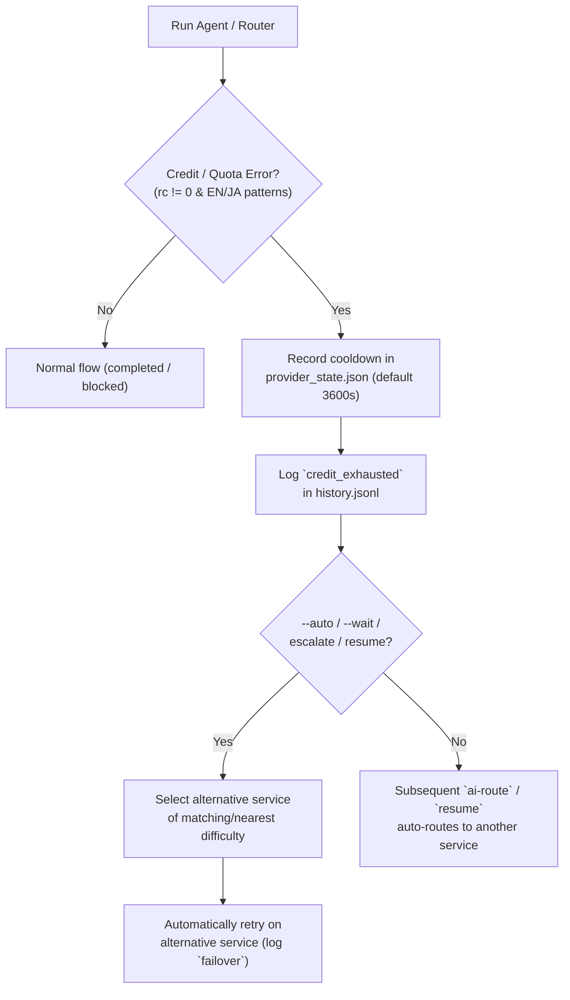

# Supported Services, ACP Mode & Credit-Exhaustion Failover

> **Languages:** **English** | [日本語](../services-and-failover.md)

---

## 1. Supported Agent Services & Invocation Specs

`ai-router` orchestrates five AI coding CLIs through a unified tool adapter layer (`src/ai_router/tools.py`):

| Service (`tool`) | Interactive Mode | Headless Mode | Effort Mapping | Notes |
| :--- | :--- | :--- | :--- | :--- |
| **`claude`** | `claude --model <m> [--effort <e>] "<prompt>"` | `claude --model <m> [--effort <e>] -p "<prompt>"` | `--effort` (`low`..`max`) | Claude Code CLI |
| **`agy`** | **ACP Interactive Bridge** (`agy acp --stdio`) | **ACP Client** (`agy acp --stdio`) | `availableModels` + `thought_level` (`max` → `xhigh`) | **Always runs via ACP mode** |
| **`opencode`** | `opencode -m <m> --prompt "<prompt>"` | `opencode run [--attach URL] -m <m> "<prompt>"` | *(omitted; unsupported by CLI)* | Also used as the default lightweight router |
| **`copilot`** | `copilot --model <m> [--reasoning-effort <e>] -i "<prompt>"` | `copilot --model <m> [--reasoning-effort <e>] --allow-all-tools -s -p "<prompt>"` | `--reasoning-effort` (`low`..`max`) | GitHub Copilot CLI; permission flag configurable |
| **`codex`** | `codex -m <m> [-c model_reasoning_effort=<e>] "<prompt>"` | `codex exec -m <m> [-c model_reasoning_effort=<e>] "<prompt>"` | `-c model_reasoning_effort=<e>` (`max` → `xhigh`) | OpenAI Codex CLI |

---

## 2. Antigravity (`agy`) ACP Mode & Compliance Notes

### How ACP Execution Works (`src/ai_router/acp.py`)

Every `agy` invocation (`run`, `review`, `multi`, `handoff`, `escalate`, `resume`, and router fallback) runs exclusively over the official Agent Client Protocol server **`agy acp --stdio`** (line-delimited JSON-RPC 2.0 over stdio):

1. Performs `initialize` → `session/new` to discover `availableModels`, `modes`, and `configOptions`.
2. Sets the ACP mode via `session/set_mode`:
   - **Implementation stages (`run`, `handoff`, `resume`, `multi`)**: defaults to **`auto`** mode (approves workspace edits and safe commands; configurable via `agy_acp_mode` or `AI_ROUTE_AGY_ACP_MODE`).
   - **Read-only stages (`planner`, `review`, `escalate`, `router`)**: always runs in **`plan`** mode and rejects edit/command `session/request_permission` requests.
3. Applies model and effort via `session/set_model` and `session/set_config_option` (`thought_level`).
4. **Interactive / tmux panes**: launches a lightweight built-in ACP interactive bridge (`python -m ai_router _acp-session ...`) inside the tmux pane, streaming output live, prompting for permission requests when needed, and keeping the same ACP `sessionId` open for follow-up turns.

### Terms of Service & Safe Usage Guidance

> [!IMPORTANT]
> **Using ACP mode alone does not exempt consumer OAuth usage from Google Antigravity's Terms of Service (Section 6).**

- **High-risk patterns (may suspend Antigravity / Gemini CLI / Gemini Code Assist access):**
  - Reusing or proxying personal consumer OAuth credentials (`oauth-personal`) inside unattended high-volume automated loops or third-party agent harnesses.
  - Rotating multiple accounts to bypass quota limits.
- **Recommended safe setup:**
  - **Personal OAuth (`oauth-personal`)**: Use for human-supervised interactive sessions (e.g., `ai-route "task"`, `ai-route -w "task"` in tmux).
  - **Automated / parallel headless workflows (`--auto`, `--wait`, `review`, `multi`)**: Authenticate via a **Google AI Studio API key (`gemini-api-key`)** or **Vertex AI (`agent-platform`)** instead of personal OAuth, or integrate via the official [Antigravity Python SDK](https://github.com/google-antigravity/antigravity-sdk-python) (`google-antigravity`).

---

## 3. Environment Auto-Detection & Multi-Service Router

### PATH Auto-Detection (`auto_detect_tools = true`)
- At routing and failover time, `ai-router` checks `PATH` and automatically filters out services whose CLI binary is not installed.
- Run `ai-route doctor` anytime to see which CLIs are detected (`OK` vs `not installed`).

### Multi-Service Routing (No Hard Dependency on `opencode`)
- `opencode` is preferred as the lightweight router when installed.
- If `opencode` is not installed, `ai-router` automatically picks the first installed alternative service (`agy` [ACP `plan` mode] → `copilot` → `claude` → `codex`) so automatic difficulty/effort classification still works out of the box.
- Set `router_tool` and `router_fallback_tools` in `config.toml` (or `AI_ROUTE_ROUTER_TOOL`) to customize routing services explicitly.

---

## 4. Credit-Exhaustion Detection & Automatic Failover



### Detection Patterns
- Detects common English & Japanese credit/quota/rate-limit messages (`credit balance is too low`, `out of credits`, `insufficient_quota`, `quota exceeded`, `usage limit reached`, `hit your limit`, `429 Too Many Requests`, `resource_exhausted`, `overloaded_error`, `クレジット不足/切れ`, `クォータ超過`, etc.).
- Clean exits (`rc == 0`) are never flagged, avoiding false positives when an agent merely discusses rate limits in normal output.
- Extend patterns with `AI_ROUTE_CREDIT_PATTERNS` (`;;`-separated regexes).

### Inspecting & Resetting Cooldowns
Cooldowns are persisted in `<log dir>/provider_state.json` and expire automatically once the cooldown window elapses (default: 1 hour). You can inspect or override them anytime:

```bash
ai-route status                         # view active cooldowns & remaining time
ai-route status --reset-credits         # clear all cooldowns immediately
ai-route status --reset-credits claude  # clear cooldown for a single service
ai-route status --mark-exhausted claude # manually mark a service exhausted
```

---

## 5. Troubleshooting

| Issue | Check | Resolution |
| :--- | :--- | :--- |
| Unexpected service selected / uninstalled CLI shown | Run `ai-route doctor` | Run `ai-route init --force` or restrict `allowed_models` in `config.toml`. |
| Refilled credits but service is still skipped | Cooldown (default 60m) is still active | Run `ai-route status --reset-credits`. |
| `agy` ACP run prompts or refuses edits | Check `agy_acp_mode` | Set `agy_acp_mode = "auto"` or `AI_ROUTE_AGY_ACP_MODE=auto` (note: read-only stages `review`/`planner`/`escalate` always use `plan`). |
| Headless `copilot` denies tool calls | Check permission flag | Ensure `copilot_permission_flag = "--allow-all-tools"` (or `"--allow-all"` inside isolated sandboxes). |
| `ai-route done` aborts on uncommitted changes | Dirty worktree state | Commit changes in the worktree first, or pass `--force` if intentional. |
