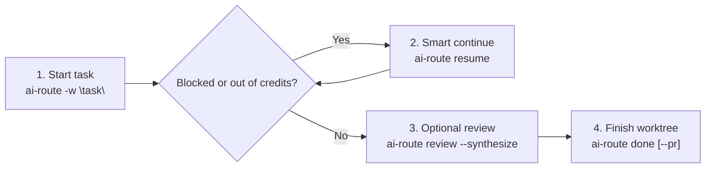

# Usage Guide (`ai-route`)

> **Languages:** **English** | [日本語](../usage.md)

`ai-router` is designed so you only need a handful of commands for daily development, while keeping full orchestration controls available when you need them.

---

## 1. Everyday Workflow

Most tasks follow a simple 3–4 command lifecycle:



---

## 2. Starting Tasks (`ai-route "..."` / `ai-route run`)

The `run` subcommand is optional: `ai-route "Fix bug"` is equivalent to `ai-route run "Fix bug"`.

### Basic Invocations

```bash
# Auto-route (difficulty + reasoning effort) and launch in tmux in the current directory
ai-route "Fix validation error on the login form"

# Isolate work in a new git worktree and `ai/<slug>-...` branch
ai-route -w "Add retry backoff to the API client"

# Branch the worktree off a specific base ref
ai-route -w --base develop "Add new endpoint"

# Highlight target/reference files for both the router and the selected agent
ai-route -w -f src/parser.py -f tests/test_parser.py "Handle empty lines safely"

# Read task details from a file (combines with a positional note if both are given)
ai-route -w -F docs/spec.md "Implement phase 1 only"

# Piped stdin is detected automatically (no need to pass `-F -`)
gh issue view 123 | ai-route -w
cat prompt.txt | ai-route --auto
```

### Execution Modes & Shortcuts

| Flag | Description |
| :--- | :--- |
| *(default)* | Launches an interactive agent in a new tmux window and appends a plan-agreement-first instruction so the agent proposes an approach before editing. |
| `--split` | Launches in a horizontal split pane of the current tmux window instead of a new window. |
| `--no-plan-first` | Skips appending the plan-agreement-first instruction in interactive mode. |
| `--mode headless` | Runs non-interactively inside tmux (output is tee'd to the session log). |
| `--auto` | **Shortcut for `--mode headless --wait`**: runs synchronously in the current shell, automatically escalates if the agent stops waiting for a decision (`blocked`), and automatically fails over to another service if credits run out (`credit_exhausted`). |
| `--no-auto-escalate` | Disables automatic escalation during `--auto` / `--wait`. |
| `--no-auto-failover` | Disables automatic cross-service failover on credit exhaustion. |
| `--dry-run` | Prints the estimated difficulty, effort, chosen `(tool, model)`, and refined prompt without launching. |
| `--no-worktree` | Overrides `worktree = true` in `[defaults]` for a single invocation. |

### Reasoning Effort (`--effort`) & Manual Model Override

The router estimates both `difficulty` (`low` / `medium` / `high`) and reasoning `effort` (`low` / `medium` / `high` / `xhigh` / `max`). You can override `effort` or bypass routing completely:

```bash
# Keep automatic model routing, but raise reasoning effort to xhigh
ai-route --effort xhigh -w "Debug subtle concurrency deadlock"

# Skip routing and force a specific tool, model, and effort
ai-route --tool claude --model opus --effort max -w "Redesign storage architecture"
ai-route --tool copilot --model gpt-5.6-sol --effort high "Apply PR review feedback"
```

### Two-Stage Flow (`-p` / `--plan` / `--two-stage`)

Separates architectural decisions (read-only planner producing structured JSON) from implementation (implementer chosen by planned difficulty & effort):

```bash
# Default (planner: claude:opus -> implementer selected by planned difficulty & effort)
ai-route -p -w "Introduce a caching layer for the API client"

# Named stage preset (`claude` | `cheap` | `gemini`)
ai-route -p --plan-preset cheap --auto "Add CSV export"

# Explicit planner/implementer (a bare tool name picks its model by planned difficulty)
ai-route -p --planner claude:opus --implementer agy -w "Split monolith module"
ai-route -p --planner agy:gemini-4-neon-high --implementer copilot:gpt-5.6-sol "Refactor handler"
```

---

## 3. Continuing & Inspecting Sessions (`resume` / `status` / `escalate` / `handoff`)

Every launched agent's output is logged to `<log dir>/sessions/<session_id>.log` so `ai-route` can inspect blocking or credit exhaustion after the fact.

### One-Command Continuation: `ai-route resume` (aliases: `continue`, `next`)

Whenever a session stalls, blocks for a decision, or hits a credit limit, run `ai-route resume` to take the right next step automatically:

```bash
# Auto-detects the current worktree's session (or the latest session from history)
ai-route resume

# Resume a specific session synchronously with auto-escalate & failover
ai-route resume 1a2b3c4d --auto

# Pass extra guidance or explicitly switch tools/effort
ai-route resume -m "Prioritize backward compatibility"
ai-route resume --tool copilot --effort high
```

**Automatic behavior by detected session state:**

| Session Status | What `ai-route resume` Does |
| :--- | :--- |
| `credit_exhausted` | Excludes exhausted services, selects an equivalent **alternative service**, and resumes with diff + output context. |
| `blocked` | Escalates to a stronger available model (skipping exhausted services) for a decision, then resumes implementation automatically. |
| `decided` | Resumes implementation immediately using the stored escalation decision. |
| `failed` / `timeout` | Resumes with current git diff and tail output context. |
| `completed` | Prints completion summary and exits (pass `-m` or `--tool` to continue with follow-up work). |
| `running` | Prints active status and log path (pass `-m` or `--tool` to hand off immediately). |

### Status & Credit Cooldowns: `ai-route status`

```bash
# Show current worktree's session (or recent 10 sessions) + active credit cooldowns
ai-route status

# Machine-readable JSON output for a session or multi group
ai-route status --from-session 1a2b3c4d --json
ai-route status --group a1b2c3

# Environment & CLI diagnostics (alias for `ai-route doctor`)
ai-route status --check

# Manage credit cooldown state
ai-route status --reset-credits              # clear all cooldowns
ai-route status --reset-credits claude       # clear cooldown for claude only
ai-route status --mark-exhausted claude      # manually mark claude as credit-exhausted
```

### Fine-Grained Controls (`escalate` / `handoff`)

When you want manual step-by-step control instead of `resume`:

```bash
# Request a decision only (no edits) and save it into session metadata
ai-route escalate --from-session 1a2b3c4d --note "Keep existing CLI flags intact"

# Request a decision and immediately resume the implementer
ai-route escalate --from-session 1a2b3c4d --tool agy --then-implement

# Hand off the current worktree/session to another model in a split tmux pane
ai-route handoff --from-session --tool claude --model opus
ai-route handoff --tool claude --model opus "Investigate the flaky concurrency test"
```

---

## 4. Finishing & Managing Worktrees (`done` / `list` / `clean`)

### One-Command Finish: `ai-route done`

Complete a worktree task in one step: verify with tests, merge (or open a GitHub PR), and clean up the worktree and `ai/` branch.

```bash
# Inside a worktree: run tests, merge into main, and delete worktree + branch
ai-route done --test-cmd "pytest -q"

# Squash-merge, or keep the worktree after merging
ai-route done --squash
ai-route done --keep

# Push branch and create a GitHub PR instead of a local merge
ai-route done --pr
ai-route done --pr --title "feat: add caching" --draft

# Preview exact git/gh commands without modifying repository state
ai-route done --dry-run
ai-route done --pr --dry-run
```

> **Tip:** If run from the main worktree while only one `ai/` worktree exists, `ai-route done` picks it automatically. When multiple exist, pass the path (`ai-route done <path>`).

### Manual Worktree Commands

```bash
ai-route list
ai-route clean ../my-repo-worktrees/fix-parser-1121-001000 --delete-branch
ai-route clean ../my-repo-worktrees/fix-parser-1121-001000 --delete-branch --force
```

---

## 5. Multi-Model Code Review (`review`)

```bash
# Parallel headless review of `git diff HEAD` using the `balanced` preset + synthesis
ai-route review --synthesize

# Review staged changes with distinct reviewer roles across the `strong` preset
ai-route review --staged --preset strong --roles --synthesize

# Review a branch diff with a custom focus and write the report to a file
ai-route review --base main --focus "race conditions and memory safety" --synthesize -o review.md

# Interactive tiled tmux panes with explicit models
ai-route review -f src/api.py --models "claude:sonnet,copilot:gpt-5.6-sol" --mode interactive

# Turn the synthesized review directly into an implementation plan (implies --synthesize)
ai-route review --then-implement
ai-route review --then-implement=claude:sonnet --impl-mode headless --wait
```

---

## 6. Parallel Multi-Model Solve (`multi` / `compare` / `pick`)

```bash
# 1. Launch multiple models in isolated worktrees from a shared base commit (requires tmux)
ai-route multi --preset strong -f src/scheduler.py "Optimize scheduler throughput"
ai-route multi --models "claude:opus,agy:gemini-4-neon-high,codex:gpt-6.1-sol" "Fix race condition"

# 2. Compare commits, diff stats, and test outcomes side by side
ai-route compare --test-cmd "pytest -q"

# 3. Pick the winning branch, merge it, and clean up all worktrees and `ai/` branches
ai-route pick                     # interactive prompt
ai-route pick 2 --squash          # squash-merge member #2
ai-route pick a1b2c3 1 --dry-run  # preview only
```

---

## 7. Analytics (`stats`) & Shell Completions (`--completions`)

### Usage Statistics (`stats`)

Aggregates model distribution, difficulty & effort breakdowns, handoff transitions, blocking/escalation counts, and credit failover events from `history.jsonl`:

```bash
ai-route stats                     # last 30 days (all repos)
ai-route stats --here --days 0     # all time for current repo
ai-route stats --recent 20         # show 20 most recent sessions
```

### Shell Completions (`--completions`)

Generates dynamic completion scripts reflecting your active `config.toml` tools and presets:

```bash
# zsh (add to ~/.zshrc)
eval "$(ai-route --completions zsh)"

# bash (add to ~/.bashrc)
eval "$(ai-route --completions bash)"

# fish
ai-route --completions fish | source
```
