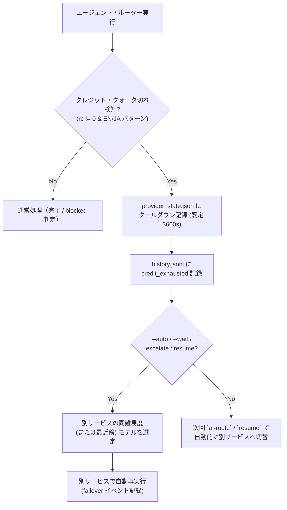

# 対応サービス・ACP モード・クレジット切れフェイルオーバー

> **Languages:** [English](en/services-and-failover.md) | **日本語**

---

## 1. 対応サービス一覧と CLI 呼び出し仕様

`ai-router` はツールアダプタ層（`src/ai_router/tools.py`）を通じて 5 つの AI コーディングエージェント CLI を統一的にオーケストレーションします。

| サービス (`tool`) | 対話モード | ヘッドレスモード | Effort 指定 | 備考 |
| :--- | :--- | :--- | :--- | :--- |
| **`claude`** | `claude --model <m> [--effort <e>] "<prompt>"` | `claude --model <m> [--effort <e>] -p "<prompt>"` | `--effort` (`low`..`max`) | Claude Code CLI |
| **`agy`** | **ACP 対話ブリッジ** (`agy acp --stdio`) | **ACP クライアント** (`agy acp --stdio`) | `availableModels` 解決 + `thought_level` (`max` → `xhigh`) | **常に ACP モードを使用** |
| **`opencode`** | `opencode -m <m> --prompt "<prompt>"` | `opencode run [--attach URL] -m <m> "<prompt>"` | *(CLI 非対応のため省略)* | 既定の軽量ルーターとしても利用 |
| **`copilot`** | `copilot --model <m> [--reasoning-effort <e>] -i "<prompt>"` | `copilot --model <m> [--reasoning-effort <e>] --allow-all-tools -s -p "<prompt>"` | `--reasoning-effort` (`low`..`max`) | GitHub Copilot CLI。権限フラグは設定で変更可能 |
| **`codex`** | `codex -m <m> [-c model_reasoning_effort=<e>] "<prompt>"` | `codex exec -m <m> [-c model_reasoning_effort=<e>] "<prompt>"` | `-c model_reasoning_effort=<e>` (`max` → `xhigh`) | OpenAI Codex CLI |

---

## 2. Antigravity (`agy`) の完全 ACP モード仕様と規約上の注意点

### 動作の仕組み (`src/ai_router/acp.py`)

`ai-router` では、`agy` のすべての実行経路（`run`, `review`, `multi`, `handoff`, `escalate`, `resume`, ルーター利用）で例外なく公式の Agent Client Protocol サーバー **`agy acp --stdio`**（JSON-RPC 2.0 over stdio）を使用します。

1. `initialize` → `session/new` でセッションを作成し、サーバーから `availableModels` / `modes` / `configOptions` を取得。
2. ステージに応じた ACP モードを `session/set_mode` で適用：
   - **実装ステージ（`run`, `handoff`, `resume`, `multi`）**: デフォルト **`auto`** モード（編集・安全なコマンドを自動承認、`config.toml` の `agy_acp_mode` や `AI_ROUTE_AGY_ACP_MODE` で変更可）。
   - **読み取り専用ステージ（`planner`, `review`, `escalate`, `router`）**: 常に **`plan`** モードで実行し、`session/request_permission` が来た場合も編集・実行を自動拒否。
3. `session/set_model` および `session/set_config_option` (`thought_level`) でモデルと effort を適用。
4. **tmux / 対話モード**: 組み込みの軽量 ACP 対話ブリッジ（`python -m ai_router _acp-session ...`）をペイン内で起動し、応答をリアルタイムストリーミング表示したうえで、同一 ACP `sessionId` のまま追加入力・権限確認の対話を継続可能。

### 利用規約上の注意点と安全な運用方針

> [!IMPORTANT]
> **ACP モードを使うこと自体は正規の外部クライアント接続方式ですが、ACP 経由であっても個人向け OAuth (`oauth-personal`) の利用規約第 6 条（Section 6）は引き続き適用されます。**

- **アカウント制限（Antigravity / Gemini CLI / Gemini Code Assist 停止）のリスクが高い使い方**
  - 個人向け定額プランの OAuth 認証を流用・プロキシして、人間の監督を離れた大量の無人ループや他社エージェントのモデルバックエンドとして使う行為
  - 複数アカウントの自動ローテーションによるクォータ枠の迂回
- **推奨される安全な使い分け**
  - **個人 OAuth (`oauth-personal`) の場合**: 人間が 1 タスクずつ tmux ペイン等で対話・確認しながら進める範囲（通常の `ai-route "..."` / `ai-route -w "..."`）で利用する。
  - **自動化・並列実行（`--auto`, `--wait`, `review`, `multi`）を本格利用する場合**: Google が公式推奨している **API キー認証（Google AI Studio の `gemini-api-key`）** または **Vertex AI（`agent-platform`）** を利用する（あるいは公式 [Antigravity Python SDK](https://github.com/google-antigravity/antigravity-sdk-python) を利用する）。

---

## 3. 環境自動検出とマルチサービス・ルーター

### 環境自動検出 (`auto_detect_tools = true`)
- ルーティング・フェイルオーバー時に `PATH` 上で実行可能な CLI だけを自動的に候補へ残します。
- たとえば `codex` が未インストールの環境では、`DEFAULT_CANDIDATES` に `codex` が含まれていても自動でスキップされます。
- `ai-route doctor` で各 CLI の検出状況（`OK` / `not installed`）をいつでも確認できます。

### 脱 `opencode` 単一依存のルーター
- 既定では `opencode` をルーターに使いますが、`opencode` が未インストールの環境ではインストール済みの別サービス（`agy` [ACP `plan` モード] → `copilot` → `claude` → `codex`）を自動選択してルーティングを行います。
- `config.toml` の `[runtime]` で `router_tool` と `router_fallback_tools` を明示設定すれば、任意のサービスをルーターとして固定したり、クレジット切れ時のルーター切替順を制御できます。

---

## 4. クレジット切れ検知と別サービスへの自動フェイルオーバー

### 仕組みの全体像



### 検知対象の例
- 英語: `credit balance is too low`, `out of credits`, `insufficient_quota`, `quota exceeded`, `usage limit reached`, `hit your limit`, `429 Too Many Requests`, `resource_exhausted`, `overloaded_error` 等
- 日本語: `クレジット残高不足 / クレジット切れ / 利用上限 / クォータ超過` 等
- 正常終了（`rc == 0`）ではコードや会話の中に "rate limit" 等の単語が含まれていても誤検知しません。
- 追加パターンは環境変数 `AI_ROUTE_CREDIT_PATTERNS`（`;;` 区切り）で拡張可能です。

### クールダウン状態の確認・リセット
- 状態は `<log dir>/provider_state.json` に保存され、クールダウン期限（デフォルト 1 時間）が過ぎると自動的に復旧します。
- クレジット補充後にすぐ戻したい場合は次を実行します：

```bash
ai-route status                        # クレジット切れ中のサービスと残り時間を確認
ai-route status --reset-credits        # 全サービスを即時復旧
ai-route status --reset-credits claude # 特定サービスのみ即時復旧
ai-route status --mark-exhausted claude # 手動でスキップ対象にする
```

---

## 5. トラブルシューティング

| 症状 | 原因・確認コマンド | 対処 |
| :--- | :--- | :--- |
| 意図しないサービスが選ばれる／未導入 CLI が候補に出る | `ai-route doctor` で導入状況と `config.toml` を確認 | `ai-route init --force` で環境に合った設定を生成、または `allowed_models` で絞り込む。 |
| クレジットを補充したのに別サービスへ振り分けられる | クールダウン（既定 60 分）が残っている | `ai-route status --reset-credits` で解除。 |
| `agy` の ACP 実行で権限確認が止まる／編集されない | `agy_acp_mode` が `default` や `plan` になっている | `config.toml` または `AI_ROUTE_AGY_ACP_MODE=auto` を設定（読み取り専用ステージの `review`/`planner` は仕様上常に `plan`）。 |
| `copilot` のヘッドレス実行でツール実行が拒否される | 権限フラグが不足している | `config.toml` の `copilot_permission_flag = "--allow-all-tools"`（必要に応じて `"--allow-all"`）を確認。 |
| `ai-route done` が「未コミット変更あり」で止まる | worktree 内にコミットされていない変更がある | worktree 内でコミットしてから再実行するか、意図的なら `--force` を付与。 |
