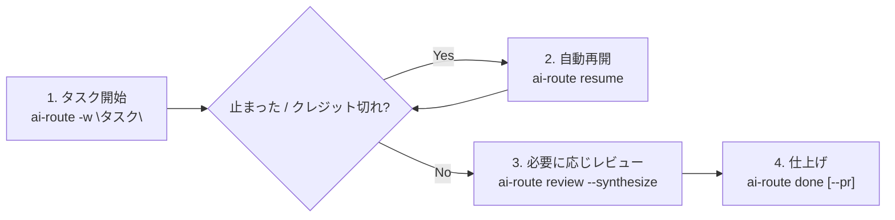

# 使い方ガイド (`ai-route`)

> **Languages:** [English](en/usage.md) | **日本語**

`ai-router` は「普段覚えるコマンドを最小限に抑えつつ、必要に応じて高度なオーケストレーションも使える」設計になっています。

---

## 1. 日常の基本ワークフロー

日常開発のほとんどは次の 3〜4 コマンドで完結します。



---

## 2. タスク実行 (`ai-route "..."` / `ai-route run`)

`run` サブコマンドは省略できます（例: `ai-route "タスク"` は `ai-route run "タスク"` と等価です）。

### 基本的な呼び出し方

```bash
# カレントディレクトリで自動ルーティング（難易度 + effort 推定）して tmux 起動
ai-route "ログイン画面のバリデーションエラーを修正して"

# 新しい git worktree と `ai/<slug>-...` ブランチを作成して隔離実行
ai-route -w "API クライアントにリトライ機能を追加"

# 特定のベースブランチから worktree を切る
ai-route -w --base develop "新規エンドポイント追加"

# 対象ファイル・参照ファイルを明示してルーターとエージェントに渡す
ai-route -w -f src/parser.py -f tests/test_parser.py "空行のエッジケース対応"

# タスク記述ファイルから読み込む（位置引数と併用すると結合される）
ai-route -w -F docs/spec.md "フェーズ1のみ実装して"

# パイプ入力（`-F -` を省略しても自動認識されます）
gh issue view 123 | ai-route -w
cat prompt.txt | ai-route --auto
```

### 実行モードとショートカット

| フラグ | 説明 |
| :--- | :--- |
| *(なし)* | デフォルト: 対話モード (`--mode interactive`) で tmux 新規ウィンドウを起動し、プロンプト末尾に「まず方針を提示して合意を得てから編集する」指示を自動付与。 |
| `--split` | 新規ウィンドウではなく、現在の tmux ウィンドウを左右分割して起動。 |
| `--no-plan-first` | 対話モードでも方針合意の事前指示を付与しない。 |
| `--mode headless` | 非対話モードで tmux 起動（実行ログは自動でセッションログに保存）。 |
| `--auto` | **`--mode headless --wait` の短縮フラグ**。カレントシェルで同期実行し、判断待ち (`blocked`) なら強いモデルへ自動エスカレーションして 1 回再開、クレジット切れ (`credit_exhausted`) なら別サービスへ自動フェイルオーバーして完走を目指す。 |
| `--no-auto-escalate` | `--auto` / `--wait` 時の自動エスカレーションを無効化。 |
| `--no-auto-failover` | クレジット切れ時の自動別サービス切替を無効化。 |
| `--dry-run` | 選定された難易度・effort・ツール・モデル・整理済みプロンプトを表示するのみで起動しない。 |
| `--no-worktree` | `config.toml` の `[defaults]` で `worktree = true` にしている場合に、1 回だけカレントディレクトリで実行する。 |

### 推論の深さ (`--effort`) とモデルの手動指定

ルーターはタスクに応じて `difficulty`（`low` / `medium` / `high`）と `effort`（`low` / `medium` / `high` / `xhigh` / `max`）を同時に推定します。必要に応じて CLI から上書きできます。

```bash
# ルーターのモデル選定は活かしつつ、effort だけ xhigh に引き上げる
ai-route --effort xhigh -w "並行処理のデッドロック原因を調査して修正"

# ルーターをスキップしてツール・モデル・effort を完全指定
ai-route --tool claude --model opus --effort max -w "アーキテクチャ刷新"
ai-route --tool copilot --model gpt-5.6-sol --effort high "PR レビュー指摘を反映"
```

### Two-stage 実行 (`-p` / `--plan` / `--two-stage`)

設計判断と実装を分離し、上位モデルで計画 JSON を確定してから下位（または指定）モデルに実装させます。

```bash
# デフォルト（planner: claude:opus -> implementer: 計画された difficulty/effort に応じて自動選定）
ai-route -p -w "API クライアントにキャッシュ層を導入"

# プリセット指定（claude / cheap / gemini）
ai-route -p --plan-preset cheap --auto "CSV エクスポート機能を追加"

# planner / implementer を個別指定（implementer にツール名だけ渡すと計画難易度に応じたモデルを自動選定）
ai-route -p --planner claude:opus --implementer agy -w "モジュール分割"
ai-route -p --planner agy:gemini-4-neon-high --implementer copilot:gpt-5.6-sol "リファクタリング"
```

---

## 3. セッションの状態確認・自動再開 (`resume` / `status` / `escalate` / `handoff`)

tmux で起動したエージェントの出力は自動的に `<log dir>/sessions/<session_id>.log` に記録されます。

### 1 コマンドで継続・復旧: `ai-route resume`（エイリアス: `continue`, `next`）

セッションが判断待ち・クレジット切れ・エラーで止まっていたら、基本的には `ai-route resume` だけ実行すれば適切な次アクションを自動実行します。

```bash
# カレント worktree（なければ直近セッション）を自動解決して継続
ai-route resume

# セッション ID を明示して同期完走モードで再開
ai-route resume 1a2b3c4d --auto

# 追加の指示や切り替え先ツールを指定して引き継ぎ
ai-route resume -m "後方互換性を最優先にして進めてください"
ai-route resume --tool copilot --effort high
```

**状態に応じた `resume` の自動挙動:**

| 検知された状態 | `ai-route resume` の動作 |
| :--- | :--- |
| `credit_exhausted` | クレジット切れ中のサービスを除外し、同難易度の**別サービスへ自動切替**して差分・出力を引き継ぎ再開。 |
| `blocked` | 強いモデル（クレジット切れ回避済み）へ**自動エスカレーション**して決定事項を取得し、そのまま実装を再開。 |
| `decided` | 既に保存済みの決定事項を使って即座に実装を再開。 |
| `failed` / `timeout` | これまでの変更差分・出力末尾を含む引き継ぎプロンプトで再開。 |
| `completed` | 完了済みサマリーを表示して終了（`-m` や `--tool` を渡せば追加作業として継続）。 |
| `running` | 実行中ステータスとログパスを表示（`-m` や `--tool` を渡せば即時引き継ぎ）。 |

### 状態とクレジットの確認: `ai-route status`

```bash
# カレント worktree（なければ直近 10 セッション）とクレジット切れ一覧を表示
ai-route status

# 特定セッションや multi グループを JSON 形式で出力
ai-route status --from-session 1a2b3c4d --json
ai-route status --group a1b2c3

# 環境・CLI インストール・設定の診断（`ai-route doctor` のエイリアス）
ai-route status --check

# クレジット切れクールダウンの手動操作
ai-route status --reset-credits              # 全サービスのクールダウン解除
ai-route status --reset-credits claude       # claude のみ解除
ai-route status --mark-exhausted claude      # 手動で claude をクレジット切れ扱いにする
```

### 個別の高度な操作 (`escalate` / `handoff`)

`resume` で自動化されている処理を個別に細かく制御したい場合に使えます。

```bash
# 強いモデルに判断だけ仰いでセッションメタに保存（編集はさせない）
ai-route escalate --from-session 1a2b3c4d --note "既存 API は維持"

# 判断取得後に続けて実装も再開
ai-route escalate --from-session 1a2b3c4d --tool agy --then-implement

# カレント worktree の差分・セッション情報を別モデルに分割ペインで引き継ぎ
ai-route handoff --from-session --tool claude --model opus
ai-route handoff --tool claude --model opus "競合テスト失敗の原因調査を引き継ぎ"
```

---

## 4. worktree の仕上げと管理 (`done` / `list` / `clean`)

### 1 コマンドで完了処理: `ai-route done`

`-w` で作成した worktree の作業が終わったら、テスト実行・マージ（または PR 作成）・後片付けを 1 コマンドで行えます。

```bash
# worktree 内で実行：テスト通過後に main へマージし、worktree と ai/ ブランチを削除
ai-route done --test-cmd "pytest -q"

# Squash マージ、または worktree を残してマージ
ai-route done --squash
ai-route done --keep

# ローカルマージの代わりに push & GitHub Pull Request を作成
ai-route done --pr
ai-route done --pr --title "feat: add caching" --draft

# 実行されるコマンドだけを事前プレビュー（git 状態は変更しない）
ai-route done --dry-run
ai-route done --pr --dry-run
```

> **Tip:** メイン worktree から実行した場合でも、アクティブな `ai/` worktree が 1 つだけなら自動で対象を検出します。複数ある場合は `ai-route done <worktreeのパス>` を指定してください。

### 一覧・手動削除

```bash
ai-route list
ai-route clean ../my-repo-worktrees/fix-parser-1121-001000 --delete-branch
ai-route clean ../my-repo-worktrees/fix-parser-1121-001000 --delete-branch --force
```

---

## 5. マルチモデルレビュー (`review`)

複数モデルで並列にコードレビューを実行し、任意で統合サマリー作成や修正実装まで繋げられます。

```bash
# git diff HEAD を balanced プリセットで並列レビュー + 統合サマリー生成
ai-route review --synthesize

# ステージ済み差分を strong プリセット＋観点分担（バグ / 設計 / セキュリティ）でレビュー
ai-route review --staged --preset strong --roles --synthesize

# ブランチ差分や特定ファイルを指定し、重点テーマを指示
ai-route review --base main --focus "競合状態とメモリリーク" --synthesize -o review.md

# 対話モードで tmux のタイルペインに並べて実行
ai-route review -f src/api.py --models "claude:sonnet,copilot:gpt-5.6-sol" --mode interactive

# 統合レビュー結果をそのまま修正計画として実装担当を起動（--synthesize を暗黙有効化）
ai-route review --then-implement
ai-route review --then-implement=claude:sonnet --impl-mode headless --wait
```

---

## 6. 並列解決・比較・採用 (`multi` / `compare` / `pick`)

同じタスクを複数モデルに別々の worktree で並列実装させ、テスト結果と差分を比較して最良の案をマージできます。

```bash
# 1. 複数モデルを並列起動（tmux 内必須）
ai-route multi --preset strong -f src/scheduler.py "タスクスケジューラのスループット改善"
ai-route multi --models "claude:opus,agy:gemini-4-neon-high,codex:gpt-6.1-sol" "難解なバグ修正"

# 2. 各 worktree のコミット数・差分・テスト結果を一覧比較
ai-route compare --test-cmd "pytest -q"

# 3. 採用するメンバーを選んでマージ & 他メンバーの worktree/ブランチを一括クリーンアップ
ai-route pick                     # 対話選択
ai-route pick 2 --squash          # 2番目を squash マージ
ai-route pick a1b2c3 1 --dry-run  # プレビューのみ
```

---

## 7. 利用統計 (`stats`) とシェル補完 (`--completions`)

### 利用統計 (`stats`)

`history.jsonl` からルーティング比率、難易度・effort 内訳、ハンドオフ遷移、ブロック・エスカレーション件数、クレジットフェイルオーバー件数を集計します。

```bash
ai-route stats                     # 直近 30 日（全リポジトリ）
ai-route stats --here --days 0     # 現在のリポジトリの全期間
ai-route stats --recent 20         # 直近 20 セッションを表示
```

### シェル補完 (`--completions`)

現在の `config.toml` に定義されたツール・プリセットを反映した補完スクリプトを出力します。

```bash
# zsh (~/.zshrc に追記)
eval "$(ai-route --completions zsh)"

# bash (~/.bashrc に追記)
eval "$(ai-route --completions bash)"

# fish
ai-route --completions fish | source
```
